  

# 🏦 Awesome Business Banking 

  
  
  
  
  
  

  <strong>🌟 Curated List of SaaS Platforms &amp; Open-Source Core Banking Engines, Financial Ledgers &amp; Treasury Rails 🌟</strong>

  <em>Focused on Business Checking, Treasury Management, Spend Controls, Double-Entry Accounting, ACH Rails &amp; Financial Operations</em>

  <strong>📅 Last updated: October 2026</strong>

---

## 📌 Overview

Welcome to **Awesome Business Banking** — the definitive, SEO-optimized directory of notable **SaaS platforms** and production-ready **open-source projects** for modern business banking. 

Whether you are a startup founder evaluating FDIC-insured business checking accounts with high APY treasury yield, or a software engineer architecting financial infrastructure with double-entry ledgers, ACH clearing, and BaaS core banking engines, this repository covers the entire commercial landscape.

### 💡 Key Focus Areas:
- 💳 **Commercial Neo-Banks & Fintech Platforms:** Managed checking, corporate cards, spend controls, automated accounts payable (AP), and cash-flow analytics.
- ⚙️ **Open-Source Core Banking Systems:** Modular backends for loan management, customer deposits, KYC, and multi-tenant banking.
- ⚖️ **Double-Entry Ledgers & Financial Cores:** Immutable ledgers, audit-compliant journal entries, and low-latency transaction routing.
- ⚡ **Payment Rails & Clearing Protocols:** Automated Clearing House (ACH), FedNow, SEPA, and wire transfer integrations.

---

## 📑 Table of Contents

- [📊 Sector Overview & Market Dynamics](#-sector-overview--market-dynamics)
- [☁️ SaaS/Hosted Platforms](#️-saashosted-platforms)
- [🔓 Open-Source GitHub Projects](#-open-source-github-projects)
  - [🏆 Top Open-Source Core Banking & Ledgers](#-top-open-source-core-banking--ledgers)
  - [🛠️ Supplementary Financial Infrastructure Tools](#️-supplementary-financial-infrastructure-tools)
- [📈 Star History](#-star-history)
- [🤝 Support & Sponsorship](#-support--sponsorship)
- [🤝 How to Contribute](#-how-to-contribute)
- [⚠️ Disclaimer](#️-disclaimer)

---

## 📊 Sector Overview & Market Dynamics

The global commercial and SME business banking market represents a massive Total Addressable Market (TAM) generating hundreds of billions of dollars annually in software, payment, and transaction fees across a multi-trillion-dollar deposit and corporate lending ecosystem. The sector exhibits a distinct dual structure: it is highly concentrated at the upper enterprise level dominated by money-center mega-banks, but moderately to highly fragmented across small-and-medium businesses (SMBs) and startups where modern fintech platforms, vertical SaaS providers, and Banking-as-a-Service (BaaS) neo-banks compete rather than a single winner taking all.

---

## ☁️ SaaS/Hosted Platforms

A curated comparison of category-leading commercial business banking and spend management platforms, sorted in descending order by **Company Scale (Valuation / Revenue)**:

| Platform | 🏢 Company Scale (Valuation / Revenue) | 💰 Pricing (Starting Tier) | 🎁 Free Tier / Trial Limits | 📝 Description | 🎯 Best For |
| :--- | :--- | :--- | :--- | :--- | :--- |
| **[Shopify Balance](https://www.shopify.com/balance)** | ~$210B Market Cap / $11.56B Revenue (FY2025) | $0/mo (Requires active Shopify store plan starting at $39/mo or $29/mo billed annually) | Free forever with Shopify store plan; includes up to 5 sub-accounts and default $5,000/day card spending limit | Business banking and financial management account natively integrated directly into the Shopify merchant admin. | Shopify merchants wanting banking, card, and payouts integrated with their commerce operations. |
| **[Brex](https://www.brex.com/)** | ~$5.2B Valuation / ~$700M Annualized Run-rate (2025) | $0/mo (Essentials plan; paid tiers start at $12/user/mo for Premium) | Free forever for Essentials plan; capped at up to 2 legal entities (max 1 global entity), 1 local card program, and standard accounting integrations | Unified corporate card, spend management, and cash management platform with built-in banking features. | Startups and enterprises wanting unified corporate cards, expense management, and business banking with high credit limits. |
| **[Mercury](https://mercury.com/)** | ~$5.2B Valuation / ~$720M Revenue (2025) | $0/mo (Standard Core Banking; optional Mercury Plus starts at $35/mo or $29.90/mo billed annually) | Free forever for core banking; $0 minimum balance, unlimited users, free ACH/standard domestic & international USD wires, up to 5 monthly reimbursed expense users | Business banking and financial operations platform combining FDIC-insured checking/savings with treasury, cards, invoicing, and bill pay. | Startups and tech companies wanting a modern, API-friendly business banking experience with integrated financial workflows. |
| **[Axos Bank](https://www.axosbank.com/)** | ~$5.2B Market Cap (NYSE: AX) / ~$1.20B Revenue (FY2025) | $0/mo (Basic Business Checking; Business Interest Checking is $10/mo or $0 with $5,000 avg balance) | Free forever on Basic Business Checking; $0 monthly maintenance fee, no minimum opening balance, unlimited digital transactions, and free incoming domestic/international wires | Full-service, chartered digital bank offering FDIC-insured business checking, high-yield savings, and commercial lending products. | Businesses wanting a full-service digital bank with traditional banking products and lending capabilities. |
| **[Novo](https://www.novo.co/)** | ~$720M Valuation / ~$298M Total Funding | $0/mo (Standard Business Checking; no monthly maintenance fee) | Free forever; $0 minimum ongoing balance ($50 initial opening deposit required), unlimited fee-free standard ACH transactions, up to 20 sub-account Reserves, and up to $7/mo in ATM fee refunds | Small business digital banking platform with checking accounts, invoicing tools, and popular accounting integrations. | Freelancers, solopreneurs, and small businesses wanting simple, fee-free business banking with accounting integrations. |
| **[Rho](https://www.rho.co/)** | ~$450M Valuation / ~$235M Total Funding | $0/mo (Core Platform; custom quote for enterprise multi-entity configurations) | Free forever for standard platform; $0 monthly fee, $0 per user (unlimited seats), $0 domestic wires & same-day ACH, and free AP automation software (AUM fee applies only for treasury balances >$50k) | High-growth corporate banking, treasury management, and accounts payable platform with high-yield operating accounts and spend controls. | Businesses wanting to maximize yield on operating cash while maintaining automated AP workflows and payment capabilities. |
| **[Grasshopper Bank](https://www.grasshopper.bank/)** | ~$369M Acquisition Valuation / $60.6M Revenue (2025) | $0/mo (Innovator Business Checking & Accelerator Checking; no monthly maintenance fee) | Free forever; $100 minimum opening deposit, no ongoing minimum balance, unlimited fee-free ACH transactions, fee-free access at MoneyPass/SUM ATMs, and mobile check deposit limits up to $25k/day | Digital-first commercial bank operating under a national banking charter, tailored for startups, small businesses, and venture funds. | Small businesses and startups wanting a digital-first bank with a traditional banking charter and API integrations. |
| **[Bluevine](https://www.bluevine.com/)** | ~$340M Acquisition Valuation / >$2B Deposits | $0/mo (Standard Checking; Plus plan is $30/mo and Premier is $95/mo, both waivable) | Free forever on Standard Checking; $0 minimum balance, unlimited standard transactions, up to 5 sub-accounts, 1 lifetime free checkbook, and 1.3% APY (with activity requirements) | Business banking and lending platform pairing business checking accounts with revolving lines of credit and AP features. | Small businesses wanting digital banking plus accessible business credit lines in a single dashboard. |
| **[Relay](https://relay.fi/)** | ~$200M Valuation / >$1.3B Deposits | $0/mo (Starter Plan; paid Grow plan is $30/mo and Scale plan is $90/mo) | Free forever on Starter Plan; $0 monthly fee, no minimum balance, up to 20 checking accounts (10 for sole props), 2 savings accounts, free standard ACH, and 1% cash back card | Business banking and cash management platform built for cash-flow visibility with sub-accounts, bill pay, and multi-user permissions. | Small businesses wanting straightforward business banking with strong account organization and cash-flow visibility. |
| **[Lili](https://lili.co/)** | ~$150M Valuation / ~$80M Total Funding | $0/mo (Lili Core; paid tiers start at Lili Pro for $15/mo, Lili Smart for $35/mo, and Lili Premium for $55/mo) | Free forever on Lili Core; $0 monthly maintenance fee, no minimum deposit, Visa debit card, fee-free MoneyPass ATM access, and basic savings account (tax automation and invoicing locked to paid tiers) | Business banking and financial management app designed specifically for solopreneurs, freelancers, and micro-businesses. | Solopreneurs and freelancers wanting basic banking with the option to upgrade for built-in expense categorization and tax tools. |

---

## 🔓 Open-Source GitHub Projects

> [!IMPORTANT]
> **Banking Service vs. Banking Infrastructure Distinction**: True turnkey, FDIC-insured business checking cannot be downloaded from GitHub. Open-source repositories provide the underlying **software engines** (core banking engines, immutable double-entry ledgers, payment protocol parsers, and neobank frontends) used by financial institutions, fintechs, and developers to build compliant banking products.

Repositories below are strictly sorted in **descending order by GitHub Stars_Count**, featuring a real-time Stars_Badge linking to each repo's stargazers page:

### 🏆 Top Open-Source Core Banking & Ledgers

- **[Apache Fineract](https://github.com/apache/fineract)** 
  - 🏛️ **Description**: The industry-standard open-source core banking platform under the Apache Software Foundation. Powers financial institutions, microfinance organizations, and digital banks across dozens of countries worldwide.
  - ✨ **Key Features**: Loan portfolio management, deposit and savings accounts, KYC document storage, real-time general ledger accounting, configurable business workflows, and modular REST APIs.
  - 💻 **Tech Stack**: Java, Spring Boot, MySQL/MariaDB, Docker, Kubernetes.
  - 🎯 **Best For**: Microfinance institutions, credit unions, community banks, and fintech engineers building digital financial services on a battle-tested core engine.

- **[OpenBankProject / OBP-API](https://github.com/OpenBankProject/OBP-API)** 
  - 🏛️ **Description**: Leading open-source RESTful API gateway and middleware platform for digital banks, enabling Open Banking compliance, PSD2, XS2A, and Open Finance interoperability.
  - ✨ **Key Features**: Provides standard API connectors for accounts, transactions, customer onboarding, counterparties, payments, entitlements, and metadata management across legacy banking cores.
  - 💻 **Tech Stack**: Scala, Akka HTTP, PostgreSQL, REST APIs.
  - 🎯 **Best For**: Banks and fintechs requiring standardized Open Banking APIs and regulatory interoperability.

- **[Formance Ledger](https://github.com/formancehq/ledger)** 
  - 🏛️ **Description**: Programmable, developer-friendly open-source core ledger engine purpose-built for fintechs and marketplaces handling complex money flows.
  - ✨ **Key Features**: Double-entry bookkeeping using the Numscript domain-specific financial modeling language, multi-asset ledgers, real-time balances, and OpenTelemetry observability.
  - 💻 **Tech Stack**: Go, PostgreSQL, Docker.
  - 🎯 **Best For**: Fintech engineers requiring programmable, multi-currency transaction ledgers for marketplaces, wallets, and disbursement engines.

- **[Blnk Finance](https://github.com/blnkfinance/blnk)** 
  - 🏛️ **Description**: Modern open-source financial ledger and backend core designed to ship fintech and digital banking products with rapid developer velocity.
  - ✨ **Key Features**: High-throughput transaction recording, automated balance snapshots, overdraft monitoring, in-flight transactions, multi-asset accounts, and idempotency guarantees.
  - 💻 **Tech Stack**: Go, PostgreSQL, Redis.
  - 🎯 **Best For**: Startups building modern neo-banks, digital wallets, or payment platforms needing an out-of-the-box double-entry core.

- **[Moov ACH](https://github.com/moov-io/ach)** 
  - 🏛️ **Description**: Robust, high-performance Go implementation and HTTP API service for reading, writing, validating, and generating NACHA-compliant Automated Clearing House (ACH) files.
  - ✨ **Key Features**: Validates SEC codes (PPD, CCD, WEB, TEL, IAT), generates check verification and automated return files, and runs as an embedded Go library or standalone Docker microservice.
  - 💻 **Tech Stack**: Go, Docker.
  - 🎯 **Best For**: US-based fintechs and banks processing direct deposits, vendor payouts, and electronic fund transfers through FedACH rails.

- **[Moov Paygate](https://github.com/moov-io/paygate)** 
  - 🏛️ **Description**: Open-source payments orchestration gateway designed to bridge customer bank accounts and corporate banking gateways without proprietary lock-in.
  - ✨ **Key Features**: Multi-rail payment submission (ACH, FedNow, Wire transfers), account micro-deposit verification, originations, and OFAC sanctions screening.
  - 💻 **Tech Stack**: Go, SQLite/MySQL, Docker.
  - 🎯 **Best For**: Companies and financial institutions automating end-to-end payment rails directly with their partner depository banks.

- **[OpenCBS Cloud](https://github.com/OpenCBS/OpenCBS-Cloud)** 
  - 🏛️ **Description**: Cloud-native core banking system designed for microfinance institutions, SME lending houses, and community banks.
  - ✨ **Key Features**: Loan portfolio origination, client account tracking, collateral register, savings accounts, and repayment scheduling.
  - 💻 **Tech Stack**: C#, .NET, PostgreSQL, Angular.
  - 🎯 **Best For**: Small and mid-size lending organizations seeking an agile alternative to legacy on-premise core banking software.

- **[Moov Wire](https://github.com/moov-io/wire)** 
  - 🏛️ **Description**: Open-source engine for reading, parsing, and validating Fedwire Funds Service formatted transaction messages.
  - ✨ **Key Features**: Compliant with Federal Reserve Bank wire transfer standards, real-time message validation, and JSON-to-Fedwire bidirectional conversion.
  - 💻 **Tech Stack**: Go.
  - 🎯 **Best For**: Institutions and high-volume treasury systems initiating and settling domestic USD wire transfers.

- **[adorsys / ledgers](https://github.com/adorsys/ledgers)** 
  - 🏛️ **Description**: Focused open-source implementation of a deposit account application and ASPSP (Account Servicing Payment Service Provider) core-banking layer.
  - ✨ **Key Features**: Built specifically for PSD2 and XS2A compliance testing, deposit account ledgers, and transaction history verification.
  - 💻 **Tech Stack**: Java, Spring Boot.
  - 🎯 **Best For**: Developers implementing open banking standards and deposit account ledgers in the European Union.

- **[Nivo Money](https://github.com/1mb-dev/nivomoney)** 
  - 🏛️ **Description**: Complete educational reference architecture demonstrating a modern neobank system composed of 9 microservices.
  - ✨ **Key Features**: Double-entry ledger, JWT authentication, RBAC, Prometheus/Grafana observability, 77+ API endpoints, and clean React dashboards.
  - 💻 **Tech Stack**: Go, PostgreSQL, Redis, React, Docker Compose.
  - 🎯 **Best For**: Fintech engineers looking to study real-world microservice architectures for neobanks.

- **[Swipelux Neobank Starter](https://github.com/swipelux/neobank-starter)** 
  - 🏛️ **Description**: A modular frontend prototype for launching a fully branded business or consumer neobank web application in minutes.
  - ✨ **Key Features**: Interactive client interface, instant balance visualization, transaction timelines, and sandboxed BaaS simulation.
  - 💻 **Tech Stack**: React, Vite, TypeScript.
  - 🎯 **Best For**: Rapid UI/UX prototyping and client demonstrations for new neobanking ventures.

---

### 🛠️ Supplementary Financial Infrastructure Tools

- ⚡ **[Lago](https://github.com/getlago/lago)**  — Open-source metering, usage-based billing, and invoicing infrastructure for B2B SaaS and high-volume fintech billing operations.
- 💳 **[Kill Bill](https://github.com/killbill/killbill)**  — Enterprise open-source billing and payment orchestration platform supporting recurring revenue, subscription management, and payment gateway routing.
- 🪙 **[0.finance](https://github.com/0-finance)** — Crypto-native business banking experiment pairing virtual accounts with self-custodied wallet rails and automated receipt categorization.

---

## 📈 Star History

---

## 💖 Support & Sponsorship

If you find this curated directory helpful for your startup, fintech engineering team, or institutional research, please consider supporting the project:

- ⭐ **Star this repository** to help others discover it!
- 🍴 **Fork and contribute** new platforms, tools, and updates.
- 📢 **Share** with your network on Twitter/X, LinkedIn, or developer communities.
- ☕ **Buy a coffee / Sponsor**: Support continued open-source curation via the [Sponsor Dashboard](https://github.com/sponsors/ishanuutta2007).

Your support keeps this resource up-to-date and founder-friendly! Thank you! 🙌

---

## 🤝 How to Contribute

We actively welcome contributions from the community! To propose additions or updates:

1. 🍴 **Fork** the repository.
2. 🌿 Create a feature branch (`git checkout -b feature/add-new-banking-platform`).
3. 📝 Update `README.md` following the existing format (include name, official link, transparent pricing/license, and target persona).
4. 🚀 Push your branch and submit a **Pull Request** with a descriptive summary.

---

## ⚠️ Disclaimer

- 📖 This repository is a **community-curated research directory** created for educational and informational purposes only. It does not constitute financial, investment, legal, or banking advice.
- 🏦 **Service vs. Infrastructure**: Regulated institutions (Mercury, Relay, Brex, Axos Bank, etc.) partner with chartered depository institutions to deliver FDIC-insured deposits. Software repositories (Apache Fineract, Formance, Moov, Blnk, etc.) provide code libraries and core engines—they do not hold funds or provide banking licenses.
- 🔍 Always review vendor pricing schedules, terms of service, and insurance eligibility directly on official company websites prior to deploying capital or opening commercial accounts.

---

  <strong>Made with ❤️ for founders, fintech engineers, and teams modernizing business banking infrastructure.</strong>

